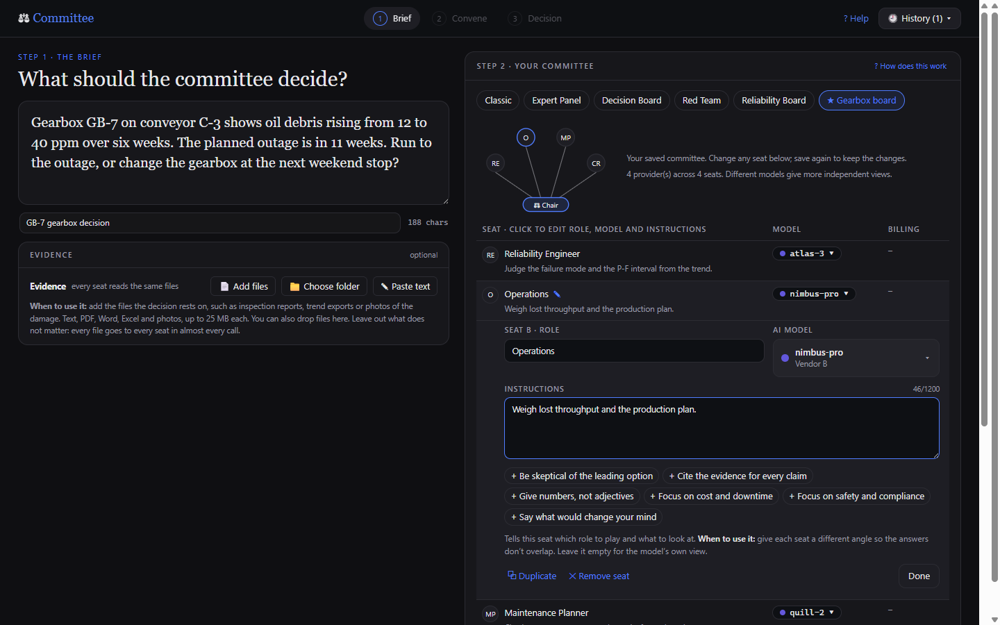
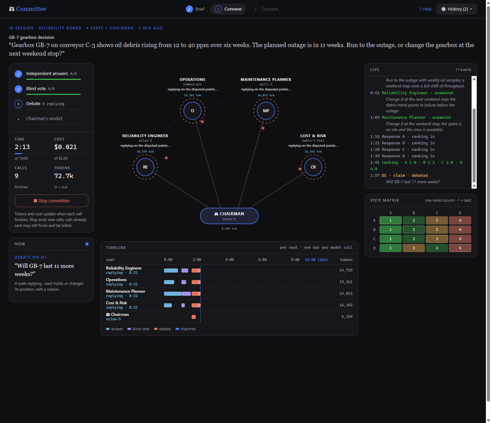
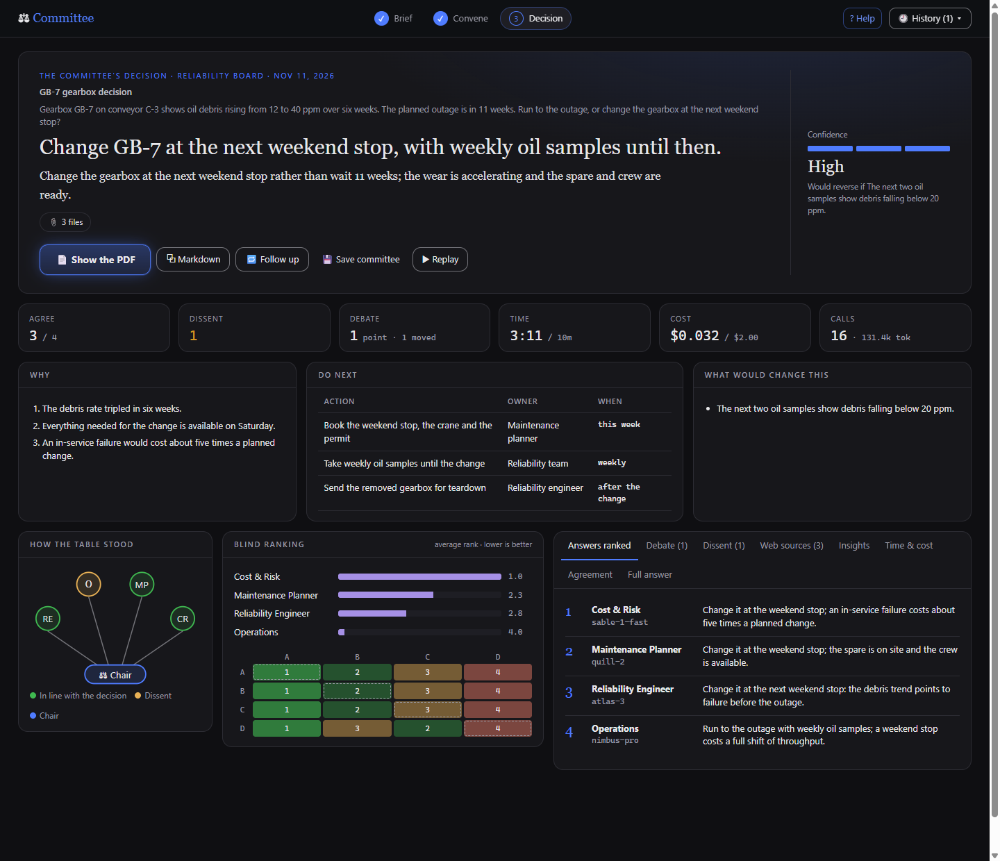

# Hermes Committee

**Ask several AI models the same hard question. They answer on their own, rank each other's
answers blind, and a chairman model writes the verdict.**

A plugin for [Hermes Agent](https://hermes-agent.nousresearch.com). Give each seat a role, a model
and its own instructions, add your evidence, let the seats debate where they disagree, and set a
time limit and budget. A Desktop page shows the run live, and every committee ends with a
decision, its dissent, next actions and a PDF report.

| 1 · Brief | 2 · Convene | 3 · Decision |
|---|---|---|
| [](docs/images/brief.png) | [](docs/images/convene.png) | [](docs/images/decision.png) |
| Ask, add evidence, switch on Research first, and give each seat a model, instructions and a thinking level. | Watch the research, the answers, the blind vote and the debate as they happen. | The verdict, its confidence, next actions, dissent and the ranking. |

<sub>Screenshots use an invented example and invented model names.</sub>

**▶ [Watch the 73-second demo on YouTube](https://www.youtube.com/watch?v=cg8Mme4T09I)**: a real committee run (used Tesla or new Corolla Hybrid?), replayed from the Desktop page. ([Download the MP4](https://github.com/abualnassr/hermes-committee/releases/download/v0.4.1/hermes-committee-1080p.mp4))

---

## Get started in 5 minutes

### 1. Install (once)

```bash
hermes plugins install abualnassr/hermes-committee
hermes plugins enable hermes-committee
hermes gateway restart
```

While you enable it, Hermes asks you to approve two things. Say yes to both:

- **two Python packages** (`fpdf2`, `uharfbuzz`), used only to write the PDF report;
- **two capabilities** (`llm.provider_override`, `llm.model_override`), so each seat can use a
  different model.

Then **restart Hermes Desktop** (or open a new session). Requires Hermes **0.23.0** or newer.

### 2. Open the Committee page

Click **Committee** in the Desktop sidebar (or press `Ctrl+K` and type *committee*).
A short 3-step guide appears at the top the first time. Hide it with **Got it**.

### 3. Ask your question

Type the decision you need in the big box at the top, for example:

> Our conveyor gearbox shows rising oil debris 11 weeks before the planned outage.
> Run it to the outage, or change it out now?

Click **📎 Add evidence** to give every AI the same facts. The seats see nothing else, so include
what matters:

- **📄 Add files**: one or more files. You can also drop files on the box.
- **📁 Choose folder**: every supported file in a folder (and two levels of sub-folders).
  Desktop asks you once to allow the plugin to read that folder.
- **✎ Paste text**: measurements, costs, logs, notes typed or pasted in.

| Format | How the seats get it |
|---|---|
| Text, Markdown, CSV, JSON | as written |
| PDF | the text of each page; a **scanned** page is read as a picture |
| Word (.docx) | text, headings, lists and tables (pictures inside it are left out; add them as photos) |
| Excel (.xlsx) | each sheet as a table, up to 2,000 rows; formulas as their last saved values |
| Photos (JPG, PNG, WebP, HEIC) | shrunk to 1568 px; see below |

Up to 25 MB per file, 60 files and 40 pictures per committee. Old `.doc`/`.xls` files: save
them as `.docx`/`.xlsx` first. Files are read **once**, when you add them. Each row shows the
size and approximate tokens; untick a file to leave it out. The seats cite the evidence as
**[E1], [E2]…** (text) and **[I1], [I2]…** (pictures).

**Photos.** A model in the committee first writes a factual description of each photo (one extra
call per picture). Every seat is then sent the photo **and** its description, so a model that
ignores pictures still has the facts; the blind vote and the chairman read the descriptions. If a
provider refuses the picture, that seat is asked again with the description only, and the plugin
remembers that model as text-only (📝 on the seat card) for next time. To decide yourself, open a
seat and set **Photos** to *Can see photos* or *Descriptions only* (cheaper for a model you know
is text-only).

**Thinking.** Each call asks the model for a reasoning level. The seats' answers and the
chairman's verdict use *medium*; the clerical steps (writing searches, picking passages,
describing photos, the blind vote, listing the disputes, debate replies) use *low*. Open a seat to
set *Thinking for the answer* to Low, Medium, High or Model default (nothing sent: the provider's
own default); the chairman row sets *Thinking for the verdict*. Some models ignore the level; a
provider that rejects it is called the way it was before, and the plugin remembers that. The
levels are three auxiliary tasks the plugin registers (`committee_think_low`, `_medium`, `_high`);
they carry only the reasoning level, the committee still picks each seat's model.
*When to use it:* raise a seat to High for a question that needs real working out; leave the
rest. A model whose default is heavy thinking gets much faster on these settings: in one test,
listing the disputes took 45 s on low against 229 s on that model's default.

*When to use it:* add the files the decision actually rests on (the inspection report, the trend
export, photos of the damage) and leave the rest out. Each file goes to every seat in almost
every call, so its token count is multiplied by about 2 × seats + 1: a 20,000-token report on a
five-seat committee is about 220,000 input tokens per run. Add photos when the condition is
easier to see than to describe; for numbers, a table or text export is cheaper and more exact
than a screenshot.

**🌐 Research first** (a switch under the evidence, off by default). Before the seats start, Hermes
turns your question into a few web searches, reads the top pages and keeps up to 8 short passages
that bear on the question, each with its source. The plugin splits each page into numbered passages
and the model picks them by number, so every passage is word for word from its page, never repeated,
and at most 2 come from one site. **Time allowed** (45 s, 1½ min by default, or 2½ min) caps how
long the research may take; after that the committee goes on with what it found. Every seat gets the same passages as evidence, cited as
**[W1], [W2]…** and marked *unverified*; the seats themselves still have no tools. On a run from the
page, the run then pauses up to 30 s with the sources listed, all ticked: untick any you do not
trust and press **Continue** (paused time does not count). It uses the web search you set up in
Hermes, costs 2 calls on the chairman's model, and adds about 2,300 tokens to each seat's input.
Only your question goes to the search provider, never your files. The sources are listed on the
Decision page (**Web sources** tab) and in the report.
*When to use it:* questions that depend on current facts, prices, standards or recent events.
Leave it off for your own data and internal decisions.

### 4. Pick your committee

Choose a **committee type** from the chips under the question:

| Committee | Seats | Good for |
|---|---|---|
| **Classic** | 4 members, same task, no roles | Any question; the purest comparison of models |
| **Expert Panel** | Domain Expert, Practitioner, Researcher, Skeptic | Technical questions |
| **Decision Board** | Strategist, Risk Officer, Operator, Finance | Choosing between options |
| **Red Team** | Pre-mortem, Assumption Auditor, Adversary, Edge-case Hunter | Stress-testing a plan or claim |
| **Reliability Board** | Mechanical Eng., Reliability Eng., Operations & Cost, HSE & Compliance, Red Team | Asset and maintenance decisions |

Then **click any seat** to edit it in the panel on the right:

- **Role**: what the seat is, for example *Mechanical Engineer*.
- **AI model**: click it to open a searchable list of every model your Hermes is connected to,
  grouped by provider. *Your active Hermes model* is always the first choice.
- **Instructions**: how this seat should think, for example *"You are a mechanical engineer. Judge
  failure modes from the evidence and give numbers."* The **+ chips** under the box add common
  ones (*Be skeptical of the leading option*, *Give numbers, not adjectives*, …).

The **+ Add seat** card adds a seat (2 to 8 seats). **Remove seat** and **Duplicate** are at the
bottom of the panel. Click **⚖ Chairman** to choose the model that writes the verdict. A strong
reasoning model works best there.

> **Tip:** different models give more independent views. If every seat uses the same model, the
> answers will be similar, and the page warns you.

### 5. Press **Convene ▶**

Hermes opens a new chat, sends the request there, and the page moves to **Convene**: the members
sit on an arc with the chairman's bench below, the stages and gauges on the left, a timeline with one
bar per model call under the table, and the live log and vote matrix on the right.

1. **Answers**: each seat works alone. A ring spins while its call is out; when it answers, its first
   line appears above it.
2. **Blind vote**: the seats show only their letters (*Response A, B, C…*), so you see the same
   blind view the voters have, and the vote matrix fills as each ballot lands.
3. **Deliberation** (only when they disagree): the chairman lists the disputed points and each seat
   holds or changes its position, with a reason.
4. **Chairman**: the chairman makes the final call, keeps the dissent and lists next actions.

Everything on the page comes from the run record: tokens and cost update when each call finishes,
and the log lists only what happened (models do not report their thinking). The ring around an
answering seat is an estimate from that model's usual time, not real progress.

A run usually takes 2–8 minutes. You stay on the Committee page: the run happens in its own chat
in the background (it appears in the sidebar under the committee's name, with the answer and the
PDF). Press **⏹ Stop committee** at any time.

**⏱ Time limit.** The chip on the Convene bar (default **10 min**) is the most the whole run may
take. The chairman's time is kept back, so you still get a verdict. If time runs short, seats that
have not answered are left out and the blind vote is skipped; the verdict and the report say so.
If even the chairman runs out of time, the run stops with "No verdict" and the answers are kept.

**🗣 Deliberate.** After the answers and the blind vote, the chairman lists the points the seats
disagree on (at most three) and tags each one: *about the action*, *about a claim* the decision rests
on, or *only emphasis*. The plugin, not the model, then decides from your setting whether to debate:

| Setting | Debates when |
|---|---|
| **When they disagree** (default) | the seats differ on the action, **or** on a fact or claim the decision rests on, even if they agree on the action |
| **Only on the action** | the seats recommend different actions |
| **Always** | every run, at least one round |
| **Never** | never: the classic three stages |

In a round, every seat sees the others' answers (by name) and must answer each point: **hold**,
**change** or **partly**, with its argument and evidence. "The majority agrees" is not accepted as a
reason. With **2 rounds**, the second covers only the points still open. The chairman then makes the
final call and says which argument decided each point; a view still held after the debate stays as
dissent. The verdict's **Deliberation** tab and the report show each seat's position before and after,
and who changed their mind and why, so you can tell persuasion by evidence from going along.

Cost and time: one round is about one more answer per seat, plus one short chairman call to list the
points; the call count on the bar shows the range (for example *9–14 model calls*). The time limit
and budget keep the chairman's share first; if no round fits, the debate is skipped and the verdict
still comes. Follow-ups keep the setting.

**⏳ Running short? Extend during the run.** On the Committee page, when about 70% of the time or
budget is used, an amber box offers **+5 min / +10 min** or **+$1 / +$2**; nothing stops while it
shows, and *Not now* hides it. If a stage is about to be skipped or cut (the blind vote, the debate,
the verdict), the run **pauses for up to 45 seconds** and asks; the paused time does not count
against your limit. *Decline*, or no answer, continues exactly as without the box, and the committee
will not ask about that limit again in this run. Limits stay within 60 minutes and $500. The live log
and the report record every extension, decline and pause. Runs started from a chat never pause.
*When to use it:* the committee is close to a good answer and you would rather spend a few more
minutes or cents than lose the blind vote or the debate.

*When to use it:* real trade-offs where reasonable experts would argue, such as run or swap,
repair or replace, or accepting a risk. Choose **Never** for fact look-ups and quick checks. Set your
own default with `hermes config set plugins.entries.hermes-committee.settings.deliberate never`.

*When to use the time limit:* keep 10 minutes for everyday questions, choose 5 for a quick check, and raise it
for long evidence, many seats or slow reasoning models. Choose **No limit** only when you will be
watching the run. Set your own default with `hermes config set plugins.entries.hermes-committee.settings.max_minutes 15`.

**💲 Budget.** The chip next to it (default **$2**) is the most the whole run may spend. Before you
press Convene, the bar shows an estimate such as *$0.08–$0.45*: the low end is a typical run, the
high end assumes every model writes its longest possible answer. The run is checked against the
high end before each stage, so it stays under your limit:

1. If the answers would not fit, each answer is made shorter (never below about 2,000 tokens).
2. If the blind vote no longer fits after the answers, it is skipped.
3. The chairman's share is kept back. If even that cannot fit, the run stops with "No verdict"
   and keeps the answers. If even a short run cannot fit, nothing is sent.

The cost is an estimate (tokens × list price), not your provider's bill.

**Subscription seats are not priced.** Hermes detects how you pay for each provider (a plan such as
a Codex or Claude subscription, an account sign-in, or an API key). Seats on a subscription show
no dollar figure and are not counted toward the budget.

**API seats are always priced**, from Hermes's own pricing tables (the ones it uses to record
session costs), else the same model's public price on OpenRouter or Nous Portal. If a pay-per-use
model has no price anywhere, the 💲 budget menu asks you to type it ($ per million tokens, in and
out); it is saved, labelled *your price*, and used by chat runs too. Convene waits until every
API seat has a price.

*When to use it:* open the 💲 budget menu to check *How you pay for each provider*. Change a
provider only if Hermes guessed wrong, for example a credits account it took for a plan.

*When to use it:* keep $2 for everyday questions on paid APIs. Lower it (for example $0.50) when
trying expensive models or a new committee. Raise it for long evidence, many seats or several
photos. Choose **No limit** when every seat is on a subscription. Set your own default with
`hermes config set plugins.entries.hermes-committee.settings.max_usd 5`. If a provider is billed
differently from what the plugin guesses, set it in `settings.billing`, for example
`{"openrouter": "paid", "my-provider": "subscription"}`.

### 6. Read the verdict

When it finishes, press **See the decision →** (or **Decision** at the top). The **decision** is at
the top with its confidence and what would reverse it, then six figures: seats in agreement,
dissent, debate, time, cost and calls.

- Under the decision, the **bottom line** in plain words (the same text as page 1 of the PDF).
- **Why**, **Do next** and **What would change this**. Next actions show an owner and a timing
  when the question or evidence names them; otherwise "—". The chairman never invents people.
- **How the table stood**: green seats are in line with the decision, amber ones dissent.
- **Blind ranking** and the vote matrix (who ranked whom; the dashed cell is a seat's own answer).
- Tabs: **Answers ranked** (click one to read it in full), **Debate** (when it was on),
  **Dissent**, **Insights**, **Time & cost**, **Agreement** and the **Full answer**.
- **📄 Show the PDF** opens the report folder; **⧉ Markdown** the same report as Markdown.
- **🔁 Follow up** asks the **same committee** a new question: the same seats,
  models, instructions, time limit and budget, with a new blind vote and a new verdict. The seats get
  the earlier question, verdict and dissent as background (untick to start fresh), and the same
  evidence; picture descriptions are reused, so photos are not paid for twice. You can add new or
  missed files in the dialog. *When to use it:* a new fact, new evidence, a changed constraint or a
  "what if" that needs the committee's judgement.
- **💬 Discuss in chat** opens the chat the committee ran in. One model answers there, not the
  committee. *When to use it:* to have the verdict explained, reworded or turned into a plan, at no
  committee cost.
- **▶ Replay** plays the run again at 10× speed, rebuilt from its saved timings, ballots and
  positions. *When to use it:* to show someone how a decision was reached, or where the time went.

**🕘 History** lists every past committee and **📊 Model standings**: how each model's answers
were ranked across all your runs.

### Name a committee

Type an optional **Committee name** above the question (for example *GB-7 gearbox decision*). It is
shown in History, on the verdict, on the report and as the chat's title. *When to use it:* when you
run several committees on one topic and want to find them again.

### Change what the verdict must contain

Each committee type comes with a brief for the chairman (for example, Red Team: "rank the
vulnerabilities by severity, say which are fatal, give the fix for each"). Click **⚖ Chairman** to
edit it, and choose whether the committee gives **an answer** or **a decision**:

- **A decision**: every seat must end with a clear recommendation and the verdict is one decision.
  *When to use it:* choosing between options, go or no-go, repair or replace.
- **An answer**: seats answer in their own way and the verdict is one combined answer.
  *When to use it:* "how", "why" or "what is best practice" questions.

A changed brief shows "· custom brief" on the Chairman row and has a **↺ Reset** link. It is saved
with the committee, so a saved committee works as your own committee type.

### Seats keep to their roles

A seat's instructions come first in what it is sent, with one rule: stay within your role, and say
in one line when a point falls outside it instead of covering it. The chairman sees each seat's
instructions and weighs each view mainly within its role. In the same verdict it notes, for every
seat with instructions, whether it **kept** to its role or **drifted**; a drifted seat gets an amber
**!** in "How the table stood" (hover for the reason) and a line in the report. The blind vote never
sees roles, so it stays anonymous.
*When to use it:* if a seat keeps drifting, sharpen its instructions: name what it judges and what
it leaves to others.

### Save a committee you like

Press **💾 Save committee** on the Convene bar (or on any verdict) and give it a name, for example
*Pump reliability board*. It keeps the seats, their models and instructions, photo settings, the
chairman, the blind vote, the time limit and the budget. It then appears under **My committees**
next to the committee types: pick it, type a new question, add new evidence and Convene. The
question and the evidence are never saved with it, so each run starts clean.

*When to use it:* a committee you will ask again, such as a reliability board for one plant or a
review panel you have tuned.

To delete one, pick it, then click **🗑 Delete** twice. Saved committees are stored in the plugin's
data folder. One written by hand in `config.yaml` (a preset) is only hidden by Delete;
`config.yaml` itself is not changed.

---

## 🔒 "Needs your OK": allowing a provider

Hermes only lets a plugin call providers you have allowed. A 🔒 next to a provider in the model
list means the committee is not allowed to use it yet.

When you press **Convene** with a 🔒 provider in the committee, the page shows the exact command
to allow it, with a **Copy** button. For example:

```bash
hermes config set plugins.entries.hermes-committee.llm.allowed_providers '["deepseek","openrouter"]'
```

Paste it into a terminal and press **Convene** again. No restart is needed. The plugin never
changes this permission itself, and you can also pick a model from a provider without a 🔒.

---

## Start a committee from any chat

You don't need the page. In any chat, type:

```
/hermes-committee:convene Should we rewrite our 10-year-old billing system or modernize it in place?
```

Hermes frames the question, gathers the evidence and runs your default preset. You can also
name the roles in plain words: *"convene a committee with a structural engineer, a planning
lawyer and a CFO"*. The Committee page follows chat runs live too.

**With attached files, don't use the slash command.** Hermes Desktop refuses a slash command
sent together with an attachment. Attach the files and ask in plain words instead:

```
Convene a committee: should we run gearbox GB-7 to the outage? Use the attached files as evidence.
Keep it under $1 and 5 minutes.
```

Hermes passes the attached files to the committee, and the time limit and budget you name are used
for this run. *When to use it:* for a quick question with one or two files. For a folder or many
files, use the Committee page, where you can see each file's size and the cost before you start.

---

## Troubleshooting

| You see | Do this |
|---|---|
| No **Committee** in the sidebar | Enable the plugin (`hermes plugins enable hermes-committee`), then restart Hermes Desktop. |
| "The committee backend is not answering" | Run `hermes gateway restart`. The page's backend loads when the gateway starts. |
| The run finished but there is no PDF | `hermes gateway restart`, then `hermes committee report <run-id>` creates the PDF from the saved run, with no new model calls. |
| "One-time permission needed" | Copy the command shown, run it in a terminal, press Convene again. See 🔒 above. |
| A seat says **no answer** | Its provider failed or timed out. The run continues while enough seats answered (the quorum). Pick a different model for that seat next time. |
| The request was typed in the chat but did not start | Press **Enter** in that chat. |
| Not sure every model works | `hermes committee doctor` makes one tiny call per seat and reports any that fail. |

---

## Cost, privacy and risk (please read)

- **One run makes 2 × seats + 1 model calls**: the seats answer, the seats vote, the chairman
  decides. The page shows the count before you press Convene. Reasoning models can use many
  tokens. Token counts are recorded for every call, with an **estimated cost** (tokens × list
  price) and a cost table by stage in the report. Your provider's bill is the real figure:
  cached prompts, discounts or taxes can make it differ.
- **The budget is checked before each call, at the call's worst case.** A call cut off by the time
  limit or by Stop may still finish at the provider: the plugin counts it at its maximum cost.
  Calls on models with no known price are not counted; the page warns before you start.
- **Your question and evidence go to every seat's provider** and the chairman's. With four seats on
  four providers, the same data reaches four companies. Keep sensitive work on providers you trust.
- **Stop** prevents new model calls within about a second. Calls already sent cannot be recalled:
  the provider may finish and bill them, but their results are discarded.
  Under a budget, such a call is counted at its maximum cost.
- **Evidence files go to every seat's provider too**, and photos to every provider whose model sees
  them (plus the vision model that describes them). Remove anything you would not send to all of them.
- **Only what you give reaches the seats.** A run from the page uses exactly the page: anything the
  chat agent tries to add (a brief, text, files) is ignored. From a chat, the agent may add a brief
  from what you said in that chat, but never facts from its memory of you. Any background the seats
  got is shown on the Decision page under the question (**Background given to the seats**).
- **Research first sends your question to your web search provider** (not your files). Web pages can
  contain text aimed at AI models; the passages are marked untrusted for every seat and the
  chairman, who are told never to follow instructions inside them.
- Reports are written **locally only**. The plugin has no telemetry, makes no network calls of its
  own and never reads API keys. All model calls go through Hermes with your existing credentials.
  Files you add are kept in the plugin's data folder: a copy per run (with the report), and the
  page's working list for 7 days.
- **Advisory only.** The result is not professional, engineering, legal, medical or financial
  approval. For those decisions, a qualified person must review it.

---

## Reference

### How it works

| Stage | What happens | Notes |
|---|---|---|
| 0. Brief | Hermes frames the question and gathers an **evidence pack** (your files, numbers, short research with sources). From the page, your evidence box is the pack. | Optional |
| 0b. Research first | One web search through Hermes's own tools; checked passages with sources join the evidence as [W1]…, the same for every seat. Page runs pause for you to untick sources. | Optional, off by default |
| 1. Answers | Every seat answers **independently and in parallel**, with its role and instructions. | Roles optional |
| 2. Peer ranking | Every seat ranks **all answers, anonymized** as Response A, B, C… Each reviewer sees them in a **different shuffled order**, and names and model ids are scrubbed from the text. | Shuffled per reviewer |
| 2b. Deliberation | Optional, after the vote. The chairman lists the disputed points and tags each (action / claim / emphasis); the **plugin** decides from the setting whether to debate. Each seat holds or changes its position per point, with a reason; 1 or 2 rounds. | Optional |
| 3. Chairman | The chairman writes the final answer from the answers, critiques, rankings and any deliberation, and says which argument decided each disputed point. It must **keep dissent visible**. | Dissent kept |
| Report | Markdown + PDF: verdict, roster, ranking matrix, agreement and dissent, one page per seat, method and usage. | Executive summary on page 1 |

Each stage is its own tool call, run by plugin code, so the model cannot skip a stage or see
identities it shouldn't, and no call gets near Hermes's 420-second tool limit.

From the page, **Convene** stores your set-up as a draft and sends
`/hermes-committee:convene draft=<id> <question>` in a new chat. The run uses exactly the seats,
models and instructions on the page; a seat set to *your active model* uses the active model.

### Presets in config.yaml

The page's **💾 Save committee** stores committees in the plugin's data folder. You can also write
presets by hand in `config.yaml`; they appear under My committees too:

```yaml
plugins:
  entries:
    hermes-committee:
      llm:
        allow_provider_override: true
        allow_model_override: true
        allowed_providers: [openai-codex, anthropic, openrouter, deepseek]   # optional allowlist
      settings:
        default_preset: my-board
        presets:
          my-board:
            template: decision-board          # roles come from the template, by position
            chairman: {provider: anthropic, model: claude-opus-4}
            seats:
              - {provider: openai-codex, model: gpt-5}
              - {provider: openrouter, model: google/gemini-3-pro}
              - {provider: deepseek, model: deepseek-chat}
              - {provider: anthropic, model: claude-sonnet-4, name: "Finance", instructions: "Judge cost and ROI."}
            review: true      # false = skip the blind vote (quicker, cheaper)
            deliberate: material   # material | action | always | never
            deliberate_rounds: 1   # 1 or 2
            quorum: 3         # minimum seats that must answer
```

Without `allowed_providers`, any connected provider may be used. With it, only the listed ones.

### Terminal commands

```bash
hermes committee templates        # the built-in committee types
hermes committee presets          # what each preset resolves to
hermes committee doctor           # one tiny call per seat to prove every route works
hermes committee runs             # recent runs and their reports
hermes committee run "question"   # run a committee headless (scripts, cron)
                                  #   --max-minutes 5 (0 = no limit), --max-usd 1.5 (0 = no limit),
                                  #   --lite (no blind vote), --research (Research first),
                                  #   --evidence-file a.pdf (repeat), --evidence-dir ./evidence
hermes committee report <run-id>  # re-create a run's Markdown and PDF (no model calls)
```

### Where the reports are

Each run is stored under `<HERMES_HOME>/plugin-data/hermes-committee/runs/<run-id>/`:

- `report.pdf`: neutral A4 layout with verdict, roster, ranking matrix, dissent, final answer, one
  page per seat, and method;
- `report.md`: the same content, searchable and copyable;
- `run.json`: the complete record (inputs, every answer, every ranking, timings, token usage).

Paragraphs containing Arabic script are set right-to-left.

### Limitations

- Seats have **no tools** of their own. They reason over the same evidence pack, so every seat
  judges the same facts. For current facts, turn on **Research first**: one shared search before
  the seats start.
- Arabic copied out of the PDF can come out garbled. It renders correctly; use `report.md` to copy text.
- The plugin runs inside the Hermes process. It cannot run under `plugins.isolation: host`
  because the live progress message uses `ctx.post_message`.

### How this differs from `hermes-council`

[`girayk/hermes-council`](https://github.com/girayk/hermes-council) is another multi-model council for Hermes.
This is a separate implementation that uses only public plugin APIs (`ctx.llm`, tools, hooks, a
bundled skill), adds no provider to your model menu, runs one stage per visible tool call with
live progress and Stop, and adds per-seat roles and instructions, templates, the evidence pack,
the Committee page and the full report.

### Development

```bash
cd tests
uv run --with "pytest>=8,<10" --with "fpdf2>=2.8,<3" --with "uharfbuzz>=0.39,<1" --with "fastapi>=0.110" python -m pytest -q
hermes plugins validate .
```

The core (`committee/`) has no Hermes imports. The tests drive the whole pipeline with a fake
LLM: anonymity guards, per-reviewer shuffling, quorum, deadlines, cancel, structured-output
fallback, drafts and the permission check, the reports, and the tool/hook glue.

## Credits and license

- The three-stage core (independent answers, anonymous peer ranking, chairman) builds on Andrej
  Karpathy's [llm-council](https://github.com/karpathy/llm-council).
- Fonts: Noto Sans and Noto Naskh Arabic, SIL Open Font License 1.1 (`assets/fonts/OFL.txt`).
- Code: MIT (see `LICENSE`).
